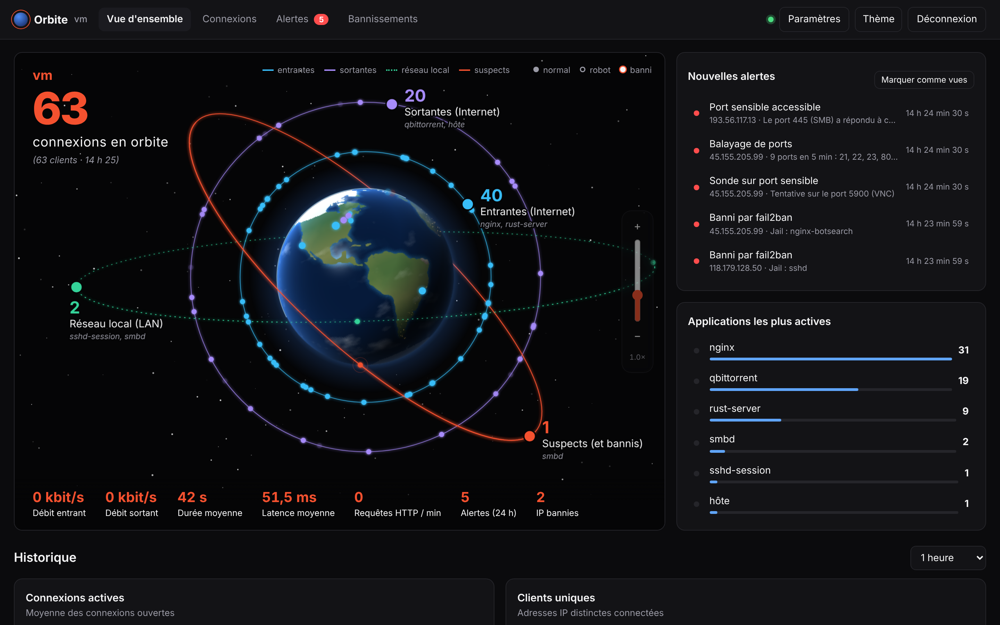
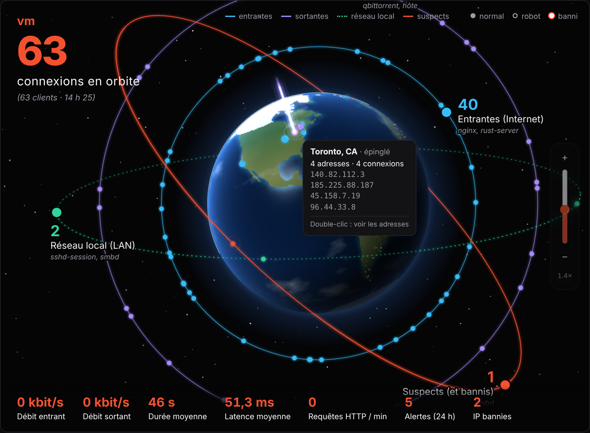
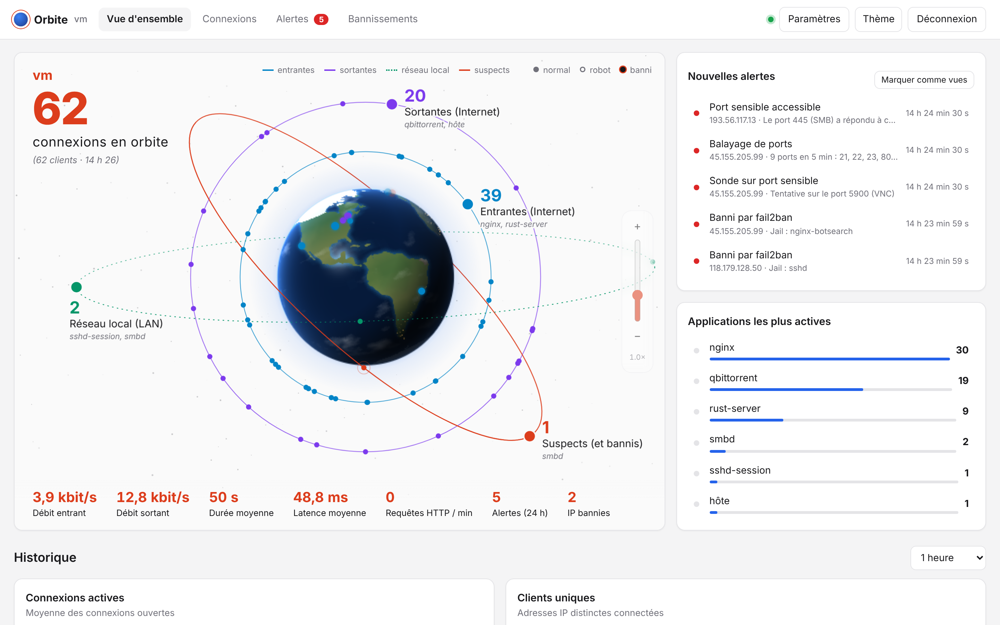
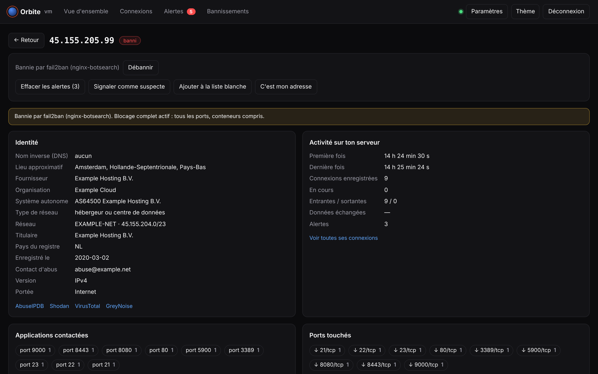
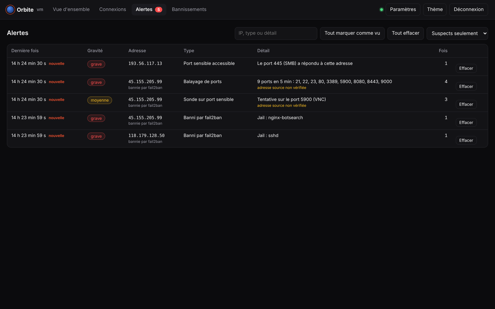
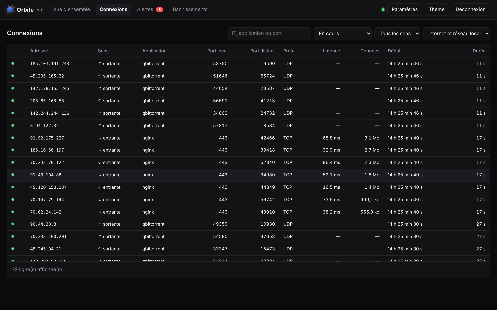
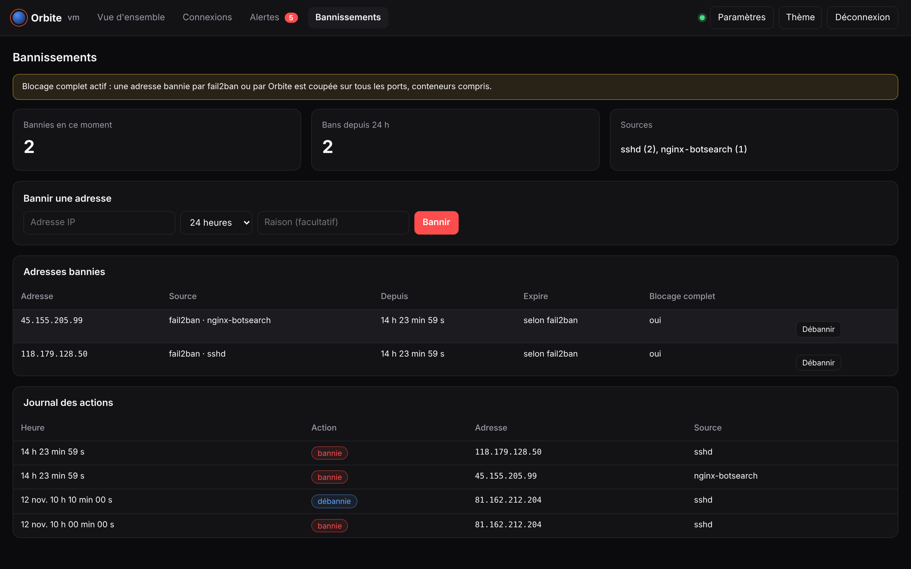
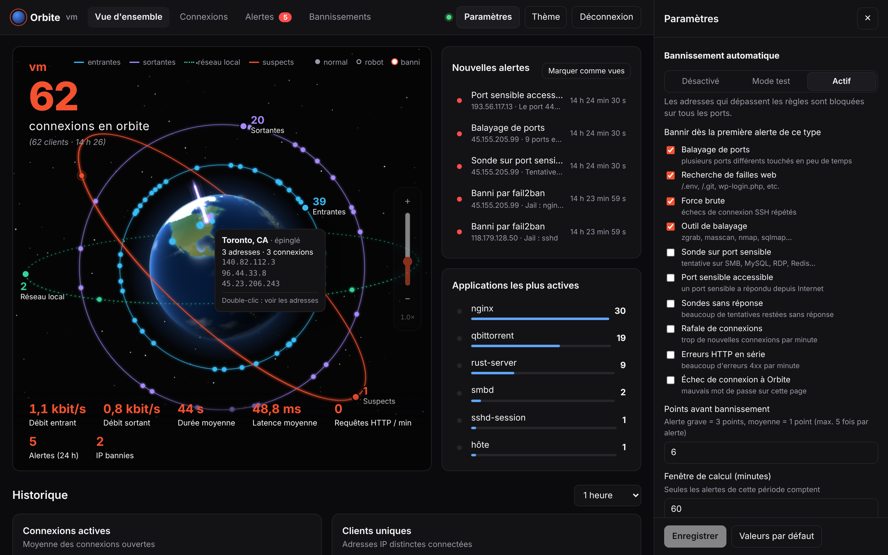
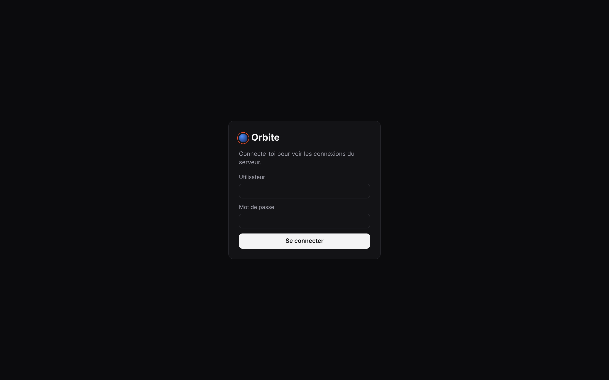

# Orbite

**Orbite montre en direct qui se connecte à ton serveur Linux** : quelle adresse, vers quelle
application, sur quel port, depuis où dans le monde. Il repère les comportements suspects
(balayages de ports, robots, force brute), peut bannir automatiquement les adresses dangereuses,
et garde un historique consultable. Le tout dans une page web auto-hébergée, avec un globe
terrestre interactif où chaque connexion est un satellite.



> Orbite est un projet personnel, développé avec l'aide de **Claude** (l'assistant IA
> d'Anthropic), qui a participé à la conception, au code, à la revue de sécurité et à cette
> documentation.

---

## Sommaire

- [Fonctionnalités](#fonctionnalités)
- [Captures d'écran](#captures-décran)
- [Comment ça marche](#comment-ça-marche)
- [Prérequis](#prérequis)
- [Installation](#installation)
- [Configuration](#configuration)
- [Utilisation](#utilisation)
- [Détection et bannissement](#détection-et-bannissement)
- [Sécurité](#sécurité)
- [Vie privée et services externes](#vie-privée-et-services-externes)
- [Dépannage](#dépannage)
- [Sauvegarde, mise à jour, désinstallation](#sauvegarde-mise-à-jour-désinstallation)
- [Structure du projet](#structure-du-projet)
- [Contribuer](#contribuer)
- [Crédits](#crédits)

---

## Fonctionnalités

**Voir**
- Toutes les connexions en cours, entrantes et sortantes, Internet et réseau local, conteneurs
  Docker compris (nom du programme ou du conteneur, ports, latence TCP, données échangées, durée).
- Un globe 3D réaliste (vrais continents, relief, nuages, lumières des villes) entouré de quatre
  anneaux : entrantes, sortantes, réseau local, suspects. Chaque client est un satellite.
- La position approximative des adresses sur la Terre.
- Des graphiques d'historique : connexions, clients uniques, latence, débit réseau, requêtes HTTP,
  alertes (de 1 heure à 30 jours).
- Une fiche détaillée par adresse : fournisseur, pays, registre réseau, applications et ports
  touchés, requêtes web, alertes, historique des bans.

**Le globe**
- Rotation libre à la souris ou au doigt ; après 30 secondes sans y toucher, il se redresse et
  recommence à tourner seul.
- Zoom à la molette (au-dessus de la Terre) ou avec le curseur semi-transparent à droite.
- Clic sur un point : ses informations restent affichées, avec un faisceau lumineux façon balise
  pour le retrouver d'un coup d'œil. Un clic ailleurs le retire.
- Double-clic sur un point : ouvre la fiche de l'adresse, ou la liste des adresses de ce lieu
  s'il y en a plusieurs.

**Protéger**
- Alertes sur les comportements suspects : balayage de ports, sondes sur ports sensibles,
  recherche de failles web, outils de scan, rafales, erreurs HTTP en série, force brute SSH,
  échecs de connexion à Orbite.
- Bannissement en un clic (pare-feu nftables, tous les ports, conteneurs compris) et débannissement
  (Orbite et fail2ban).
- Bannissement automatique configurable, avec mode test, récidive et durées croissantes.
- Liste blanche, « c'est mon adresse » (boucle NAT), signalement manuel, effacement d'alertes.
- Lecture des journaux nginx, SSH et fail2ban.

**Confort**
- Thème sombre et clair, interface en français, responsive (téléphone compris).
- Panneau de paramètres : tout se règle depuis l'interface, sans redémarrer.
- Bouton Retour du navigateur pris en charge, liens partageables vers chaque vue.

## Captures d'écran

| | |
|---|---|
|  |  |
| Zoom et balise sur un lieu épinglé | Thème clair |
|  |  |
| Fiche d'une adresse | Alertes |
|  |  |
| Connexions | Bannissements |
|  |  |
| Panneau de paramètres | Page de connexion |

Les captures viennent d'une simulation : les adresses et les fournisseurs sont fictifs.

## Comment ça marche

```
          Internet
             │
        ┌────▼─────┐   HTTPS    ┌────────────────────────────────────────────┐
        │  nginx   ├───────────►│ Orbite (conteneur, réseau de l'hôte)       │
        └──────────┘ 127.0.0.1  │                                            │
                                │  collecteur ── conntrack, ss, /proc/net    │
                                │  journaux   ── nginx, auth.log, fail2ban   │
                                │  détection  ── alertes, points, bans auto  │
                                │  pare-feu   ── table nftables inet orbite  │
                                │  SQLite     ── ./data/orbite.db            │
                                │  page web   ── HTML, CSS, JS sans framework│
                                └────────────────────────────────────────────┘
```

- **Backend** : Python 3 (bibliothèque standard uniquement), SQLite en mode WAL.
- **Frontend** : HTML, CSS et JavaScript sans dépendance ni étape de compilation. Le globe est
  dessiné pixel par pixel dans un `<canvas>` (aucune image ni bibliothèque 3D).
- **Collecte** toutes les 5 secondes :

| Donnée | Source |
|---|---|
| Connexions, ports, sens, octets | `conntrack -L` (inclut le trafic vers les conteneurs) |
| Nom du programme, latence TCP | `ss` sur l'hôte |
| Débit réseau | `/proc/net/dev` |
| Nom des conteneurs | socket Docker |
| Requêtes web, robots, scans | `/var/log/nginx/access.log` |
| Force brute SSH | `/var/log/auth.log` |
| Bannissements fail2ban | `/var/log/fail2ban.log` |

## Prérequis

- Un serveur Linux (testé sur Ubuntu) avec **Docker** et **Docker Compose**.
- **nginx** comme proxy inverse, avec HTTPS (Let's Encrypt, nginx-ui, etc.).
- Optionnel : **fail2ban** (pour l'afficher et débannir depuis Orbite).
- Le noyau doit fournir conntrack et nftables (c'est le cas des distributions courantes).

Pour avoir le volume de données par connexion, active la comptabilité conntrack :

```bash
echo "net.netfilter.nf_conntrack_acct=1" | sudo tee /etc/sysctl.d/99-orbite.conf
sudo sysctl --system
```

## Installation

```bash
git clone https://github.com/<ton-compte>/orbite.git
cd orbite
cp .env.example .env
nano .env               # au minimum : ORBITE_PASSWORD (8 caractères ou plus)
chmod 600 .env
docker compose up -d --build
docker logs --tail 20 orbite
```

Le journal doit afficher `Orbite écoute sur http://127.0.0.1:8095`. Orbite n'écoute que sur
la boucle locale : il faut passer par nginx.

### nginx

Crée un site (par exemple `orbite.example.com`) avec HTTPS, puis :

```nginx
server {
    listen 443 ssl;
    server_name orbite.example.com;
    # ssl_certificate ... ; ssl_certificate_key ... ;

    # Fortement conseillé : n'autoriser que ton réseau local ou ton VPN
    # allow 192.168.1.0/24;
    # deny all;

    location / {
        proxy_pass http://127.0.0.1:8095;
        proxy_set_header Host $host;
        proxy_set_header X-Real-IP $remote_addr;
        proxy_set_header X-Forwarded-For $proxy_add_x_forwarded_for;
        proxy_set_header X-Forwarded-Proto $scheme;
    }
}
```

`X-Real-IP` est indispensable : c'est ce qui permet à Orbite de connaître ta vraie adresse (pour
ne jamais te bannir et limiter les tentatives de connexion).

Recharge nginx (`sudo nginx -t && sudo systemctl reload nginx`), puis ouvre la page.

## Configuration

Le fichier `.env` donne les valeurs de départ. Presque tout se change ensuite dans le panneau
**Paramètres** de l'application ; ces réglages sont gardés dans la base et ont priorité sur `.env`.

| Variable | Défaut | Rôle |
|---|---|---|
| `ORBITE_USER` | `admin` | Nom d'utilisateur |
| `ORBITE_PASSWORD` | *(vide)* | Mot de passe, 8 caractères ou plus (obligatoire) |
| `ORBITE_BIND` | `127.0.0.1` | Adresse d'écoute |
| `ORBITE_PORT` | `8095` | Port d'écoute |
| `ORBITE_SESSION_HOURS` | `168` | Durée d'une session (heures) |
| `ORBITE_RETENTION_DAYS` | `30` | Jours d'historique gardés |
| `ORBITE_INTERVAL` | `5` | Secondes entre deux relevés |
| `ORBITE_AUTOBAN` | `on` | Bannissement automatique : `on`, `test` ou `off` |
| `ORBITE_ENFORCE_F2B` | `1` | Bloquer sur tous les ports les adresses bannies par fail2ban |
| `ORBITE_WHITELIST` | | Adresses ou plages jamais signalées ni bannies |
| `ORBITE_OWN_IPS` | | Tes adresses publiques (boucle NAT) |
| `ORBITE_IGNORE_APPS` | | Applications à ne pas journaliser (ex. `qbittorrent`) |
| `ORBITE_IGNORE_PORTS` | | Ports locaux à ignorer |
| `ORBITE_LOG_LAN` | `1` | Journaliser le trafic du réseau local |
| `ORBITE_FLAG_LAN` | `0` | Signaler aussi les adresses du réseau local |
| `ORBITE_RDNS` | `1` | Résolution DNS inverse des adresses |
| `ORBITE_LOOKUP` | `1` | Renseignements sur une adresse (rdap.org, ip-api.com) |
| `ORBITE_GEO_POINTS` | `1` | Points des adresses sur la Terre (ip-api.com) |
| `ORBITE_PORTSCAN_PORTS` | `6` | Ports différents en 5 min pour un balayage |
| `ORBITE_FLOOD_PER_MIN` | `100` | Nouvelles connexions par minute pour une rafale |
| `ORBITE_PROBES` | `10` | Tentatives sans réponse en 5 min |
| `ORBITE_HTTP_ERRORS_PER_MIN` | `20` | Erreurs HTTP par minute |
| `ORBITE_AUTH_FAILS` | `5` | Échecs SSH en 10 min pour de la force brute |

## Utilisation

- **Vue d'ensemble** : le globe, les compteurs, les nouvelles alertes, les applications les plus
  actives et l'historique.
- **Connexions** : la liste filtrable (adresse, application, port, sens, Internet ou local), en
  cours ou historique complet.
- **Alertes** : tous les signalements, avec « Tout marquer comme vu » (plus de notification) et
  « Tout effacer » (les adresses redeviennent normales, l'historique est gardé).
- **Bannissements** : bannir une adresse à la main, voir les bans en cours et le journal.
- **Fiche d'une adresse** (clic sur une IP ou un satellite) : bannir ou débannir, effacer ses
  alertes, la signaler, l'ajouter à la liste blanche, ou indiquer que c'est ton adresse.

### Le globe

| Action | Effet |
|---|---|
| Glisser sur la Terre | La faire pivoter dans tous les sens |
| Molette au-dessus de la Terre | Zoomer ou dézoomer (ailleurs, la page défile normalement) |
| Curseur à droite, `+`, `−` | Zoomer ; clic sur la valeur pour revenir à 1× |
| Survol d'un point | Lieu, nombre d'adresses et de connexions |
| Clic sur un point | Épingler ses informations et afficher la balise lumineuse |
| Clic ailleurs | Retirer l'épingle |
| Double-clic sur un point | Ouvrir la fiche de l'adresse, ou la liste des adresses du lieu |
| Clic sur un satellite | Ouvrir la fiche de l'adresse |

En zoomant, les anneaux et les satellites s'effacent pour laisser voir la carte. Le niveau de
zoom est retenu dans ton navigateur.

### « C'est mon adresse »

Quand tes appareils ouvrent tes propres domaines depuis chez toi, le routeur les renvoie vers le
serveur (boucle NAT) et ils arrivent avec ton IP publique. Marque-la comme « mon adresse » : ses
connexions passent sur l'anneau du réseau local et ne sont jamais signalées.

### Mot de passe oublié

Si tu as changé le mot de passe dans l'application et l'as oublié :

```bash
docker compose stop
sqlite3 data/orbite.db "DELETE FROM kv WHERE k='password_hash'"
docker compose start
```

Celui du fichier `.env` redevient valide.

## Détection et bannissement

### Règles

| Alerte | Déclencheur (par défaut) | Gravité |
|---|---|---|
| Balayage de ports | 6 ports différents ou plus en 5 minutes | grave |
| Sonde sur port sensible | SMB, MySQL, Redis, RDP, VNC… depuis Internet | grave |
| Port sensible accessible | un port sensible a répondu à Internet | grave |
| Recherche de failles web | `/.env`, `wp-login.php`, `.git/`… | grave |
| Outil de balayage | sqlmap, nikto, masscan, zgrab… | grave |
| Force brute | 5 échecs SSH en 10 minutes | grave |
| Rafale de connexions | 100 nouvelles connexions en 1 minute | moyenne |
| Sondes sans réponse | 10 tentatives sans réponse en 5 minutes | moyenne |
| Erreurs HTTP en série | 20 erreurs 4xx par minute | moyenne |
| Échec de connexion à Orbite | à chaque échec, grave au 5e | moyenne |
| Robot d'indexation | moteurs de recherche, aperçus de liens | info |

### Bannissement

Un ban ajoute l'adresse à une table nftables propre à Orbite (`inet orbite`). Toute nouvelle
connexion entrante de cette adresse est refusée, sur tous les ports, conteneurs Docker compris.
Les connexions que ton serveur ouvre lui-même continuent de fonctionner. Les bans sont remis en
place au redémarrage. Pour tout retirer à la main : `sudo nft delete table inet orbite`.

### Bannissement automatique

Une adresse est bannie :

- dès sa première alerte d'un type choisi (par défaut : balayage de ports, recherche de failles
  web, force brute, outil de balayage) ;
- ou quand ses alertes atteignent 6 points en 60 minutes (grave = 3 points, moyenne = 1 point).

La durée par défaut est de 24 heures, doublée à chaque récidive. Le **mode test** affiche les
adresses qui auraient été bannies, sans les bloquer : idéal pour régler les seuils.

Ne sont **jamais** bannies automatiquement : les adresses locales, la liste blanche, tes
adresses publiques, et les adresses connectées à Orbite.

## Sécurité

Orbite a été relu avec la sécurité en tête. Ce qu'il faut savoir :

**Le conteneur équivaut à un accès root.** Pour voir et bloquer les connexions, il tourne avec le
réseau et les processus de l'hôte, `NET_ADMIN`, `SYS_PTRACE` et le socket Docker. Une faille dans
Orbite donnerait le contrôle du serveur : **limite l'accès à la page** (règles `allow`/`deny` de
nginx, ou VPN) et garde un mot de passe long et unique. Tu peux retirer les montages du socket
Docker et de fail2ban dans `docker-compose.yml` : les conteneurs apparaîtront alors par adresse,
et la fiche affichera la commande fail2ban à lancer toi-même.

**Ce qui est en place**

- Mot de passe haché avec PBKDF2-SHA256 (600 000 tours) et sel aléatoire ; comparaison en temps
  constant ; 5 essais par adresse toutes les 15 minutes.
- Session dans un cookie `HttpOnly`, `SameSite=Strict`, `Secure` derrière HTTPS.
- Requêtes de modification en JSON uniquement (protection CSRF), corps limité à 64 Ko.
- En-têtes de sécurité : CSP stricte sans script en ligne, `X-Frame-Options`, `nosniff`,
  `Referer` limité.
- L'adresse du client vient de `X-Real-IP` **seulement** si la requête arrive de nginx sur la
  boucle locale ; `X-Forwarded-For`, falsifiable, est ignoré.
- Requêtes SQL paramétrées, commandes système lancées sans shell, adresses IP validées partout.
- Interface construite sans `innerHTML` : tout texte venant de l'extérieur (journaux, noms DNS,
  user-agents) est affiché comme du texte, jamais comme du code.
- Base de données et dossier `data/` lisibles par root uniquement (droits 600 et 700).
- Anti-usurpation : une alerte basée sur des paquets sans poignée de main TCP (scan SYN, UDP)
  peut venir d'une adresse falsifiée. Elle est marquée « non vérifiée » et ne déclenche jamais de
  ban automatique, pour qu'un attaquant ne puisse pas te faire bannir des adresses légitimes.

**Derrière Cloudflare ou un autre proxy**, configure `real_ip` dans nginx. Sinon nginx ne voit que
les adresses du proxy, et Orbite risque de les signaler.

Tu as trouvé une faille ? Ouvre une issue sans détails exploitables, ou contacte le mainteneur
en privé.

## Vie privée et services externes

Orbite fonctionne entièrement chez toi. Deux options envoient des adresses IP à l'extérieur :

| Option | Service | Quoi | Cache |
|---|---|---|---|
| `ORBITE_GEO_POINTS` | [ip-api.com](https://ip-api.com) | adresses connectées, par lots de 100 | 30 jours |
| `ORBITE_LOOKUP` | [rdap.org](https://rdap.org), ip-api.com | l'adresse dont tu ouvres la fiche | 7 jours |

L'offre gratuite d'ip-api.com passe en HTTP non chiffré et est réservée à un usage non
commercial. Mets ces options à `0` (ou décoche-les dans les paramètres) pour ne rien envoyer.
Aucune statistique ni télémétrie n'est collectée par Orbite.

## Dépannage

| Problème | Solution |
|---|---|
| Le conteneur s'arrête au démarrage | `ORBITE_PASSWORD` manquant ou trop court : regarde `docker logs orbite` |
| 502 Bad Gateway | Orbite ne tourne pas, ou nginx pointe vers un mauvais port |
| « Données » toujours vides | Active `nf_conntrack_acct` (voir Prérequis) |
| Les conteneurs apparaissent par IP | Le socket Docker n'est pas monté |
| « Le pare-feu d'Orbite n'est pas actif » | Vérifie `NET_ADMIN` et que `nft` fonctionne sur l'hôte |
| Je me suis banni | Impossible depuis la page connectée ; sinon `sudo nft delete table inet orbite` |
| Toutes les connexions viennent de mon IP | Boucle NAT : clique sur « C'est mon adresse » dans sa fiche |
| Aucun point sur la Terre | `ORBITE_GEO_POINTS=0`, ou ip-api.com inaccessible depuis le serveur |
| La Terre est lente sur un vieil appareil | La qualité s'adapte seule ; dézoome ou coupe l'animation dans Paramètres › Affichage |

## Sauvegarde, mise à jour, désinstallation

```bash
# Sauvegarde (base cohérente même en marche)
sqlite3 data/orbite.db ".backup orbite-$(date +%F).db"

# Mise à jour
git pull
docker compose up -d --build

# Désinstallation
docker compose down
sudo nft delete table inet orbite 2>/dev/null
cd .. && rm -rf orbite
```

## Structure du projet

```
orbite/
├── app/
│   ├── server.py      serveur web et API
│   ├── collector.py   relevé des connexions (conntrack, ss, Docker)
│   ├── detect.py      règles de détection et alertes
│   ├── firewall.py    bans nftables et bannissement automatique
│   ├── logs.py        lecture des journaux nginx, SSH, fail2ban
│   ├── geo.py         positions des adresses (ip-api.com, cache)
│   ├── ipinfo.py      renseignements d'une adresse (RDAP, ip-api.com)
│   ├── f2b.py         débannissement fail2ban
│   ├── settings.py    paramètres et mot de passe
│   ├── db.py          base SQLite
│   └── static/        page web (index.html, app.js, style.css, earth.js…)
├── docs/              captures d'écran
├── Dockerfile
├── docker-compose.yml
└── .env.example
```

L'API est privée (session obligatoire) : `GET /api/live`, `/api/connections`, `/api/flags`,
`/api/bans`, `/api/series`, `/api/ip`, `/api/place`, `/api/settings`… et des `POST` pour les
actions (`/api/ban`, `/api/unban`, `/api/flag`, `/api/trust`…).

## Contribuer

Les suggestions et corrections sont bienvenues : ouvre une issue ou une pull request.

- Le backend n'utilise que la bibliothèque standard de Python : merci de garder cette contrainte.
- Le frontend n'a ni framework ni compilation ; tout texte externe passe par des nœuds texte
  (`h()` dans `app.js`), jamais par `innerHTML`.
- Ne publie jamais ton `.env` ni le dossier `data/` (ils sont dans `.gitignore`).

## Crédits

- Développé avec l'aide de **Claude**, l'assistant IA d'[Anthropic](https://www.anthropic.com),
  pour la conception, le code, la revue de sécurité et la documentation.
- Carte terre/mer : jeu de données **GLOBE** de la NOAA (domaine public), via
  [global-land-mask](https://github.com/toddkarin/global-land-mask).
- Géolocalisation : [ip-api.com](https://ip-api.com). Registres réseau : [rdap.org](https://rdap.org).
- Inspiré du style de [Beszel](https://github.com/henrygd/beszel).

Aucune licence n'a encore été choisie : tant qu'un fichier `LICENSE` n'est pas ajouté, le code
reste sous droits réservés par défaut. Pour un projet ouvert, la licence MIT est un choix simple.
